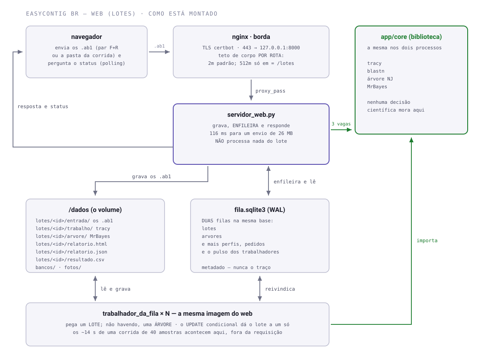

# EasyContig BR — web

Fachada web do EasyContig BR. Sobe um par F+R — ou a pasta inteira de uma
corrida — e devolve o alinhamento, os dois cromatogramas acoplados, a
identificação, o relatório e o CSV. No lote pronto, uma árvore Bayesiana por
marcador. Na página da amostra, o traço em canvas: arrasta, muda amplitude,
edita base — e o consenso só vira definitivo na exportação.

Por que a web começa pelo lote, e não pelo app inteiro no navegador:
[ADR 0050][adr50]. Resumo: o lote é 100 % backend, já estava implementado, e
é o que o laboratório pediu na prática duas vezes.

## Como está montado



O servidor web **não processa nada**. Ele grava os arquivos, põe o lote na
fila e responde — 116 ms para um envio de 26 MB, medido. Os ~14 s de montagem
e identificação acontecem no trabalhador, onde ninguém está com uma conexão
aberta esperando — é essa separação que faz o serviço aguentar 100 pessoas na
mesma máquina que aguentaria 20.

Nenhuma decisão científica mora na web. Montagem, identidade, limiares, o
texto das ressalvas e a árvore são do núcleo — os módulos na raiz deste
repositório —, e a web só chama, grava e mostra. O núcleo não sabe que a web
existe: nenhum módulo da raiz importa `easycontig_web`.

**Duas filas no mesmo banco, um trabalhador só.** O envio de lote e o pedido de
árvore são filas separadas (`lotes` e `arvores`), e o laço do trabalhador tenta
primeiro um lote e, não havendo, uma árvore — o que mantém a corrida de alguém
na frente do enfeite. As duas se reivindicam pelo mesmo `UPDATE` condicional,
então subir mais réplicas continua seguro.

**A regra de ouro tem uma exceção, e ela é medida.** Reabrir uma amostra no
workspace e montar um banco de referência rodam `tracy`/`blastn` no próprio
processo web, atrás de um semáforo de `EASYCONTIG_MAX_PESADAS` vagas (3 no
compose): quem exceder leva 503 na hora, em vez de segurar a thread que o resto
do site usa. É a única coisa pesada que acontece dentro de uma requisição.

**O teto de corpo é do nginx, e é por rota.** O padrão do `server` é 2 MB; só
`= /lotes` sobe para 512 MB, `= /bancos/meu` para 32 MB e `= /perfil` para 8 MB.
O Starlette spoola o corpo inteiro em disco **antes** de a rota rodar, então
cota e `max_bytes` só agem depois de os bytes já terem subido — quem segura é o
arquivo em `implantacao/`.

### Onde os dados param

Tudo num lugar só, e é de propósito: a promessa das ADRs 0050/0057 é que migrar
o serviço seja **copiar uma pasta**. No servidor essa pasta é `/var/lib/easycontig`
(montada como `/dados` no contêiner); em desenvolvimento é o que estiver em
`EASYCONTIG_DATA_DIR`.

```
<EASYCONTIG_DATA_DIR>/
├── lotes/<id>/entrada/*.ab1     os traços como o usuário mandou — é o peso
├── lotes/<id>/trabalho/         as saídas intermediárias do tracy
├── lotes/<id>/arvore/           o que o MrBayes produziu
├── lotes/<id>/relatorio.html · relatorio.json · resultado.csv
├── fila.sqlite3                 as duas filas, perfis, pedidos e pulso
├── bancos/                      os bancos de referência que o usuário monta
└── fotos/                       as fotos de perfil
```

Um lote de 40 amostras (80 `.ab1`) ocupa **~98 MB** depois de processado, e a
entrada mais o `trabalho/` respondem por quase tudo. **Não há banco de dados
fora daqui:** o `fila.sqlite3` guarda metadado, não traço.

`EASYCONTIG_RETENCAO_DIAS` (30 no compose) é o que apaga a pasta do lote quando
o prazo vence, contado do `criado_em`, na faxina que o trabalhador roda de hora
em hora. **Apagar não tem desfazer, e ninguém é avisado antes** — veja "O que
ainda não está feito".

## Árvore filogenética do lote

No lote pronto há um botão **Árvore filogenética**: ele enfileira uma
inferência Bayesiana (**MrBayes**) das amostras da corrida entre si, com
probabilidade posterior nos ramos. É pergunta diferente da identificação —
aquela responde "de que espécie é esta amostra" (BLAST contra referências);
esta responde "como as amostras se agrupam, e o quanto isso se sustenta".

Sai **uma árvore por marcador**, e isso é uma trava, não uma preferência:
16S e groEL não são homólogos, e uma árvore com os dois misturados sairia
bonita e falsa. O marcador vem do **nome da amostra**, com o banco do lote
como reserva.

Três defesas que o MrBayes sozinho não dá, e que são o motivo de a árvore
morar no `filogenia.py` e não num script: apara as colunas que só existem em
consenso parcial, avisa quando as amostras são quase idênticas (o "leque" é
resultado honesto, não falha), e traduz a convergência do MCMC em uma frase
em vez do ASDSF cru.

Precisa do `mb` no PATH (ou `EASYCONTIG_MRBAYES_BIN`) — o MrBayes não vem de
`pip` nem de repositório de distribuição; o `Dockerfile` o compila.

## Onde cada coisa mora

Os arquivos são separados por assunto, e o nome diz a função. Quem procura
algo abre a pasta, não o arquivo. Todo módulo começa com uma docstring que
tem o fluxograma, "como funciona", "como usar" e "o que mudou"; e todo módulo
tem um `main()` no fim que o faz rodar sozinho (`python lote.py`,
`python -m easycontig_web.configuracao`) — é o jeito mais rápido de ver o
que ele faz.

### O núcleo — a raiz do repositório

⚠️ **Estes doze módulos e o front (`easycontig_web/templates/` e
`easycontig_web/estatico/`) NÃO são versionados aqui** (decisão de
08/09/2026): eles são o mecanismo — a ciência e a tela — e ficam só nas
máquinas que precisam deles. O repositório carrega o andaime. Um clone limpo
não sobe e não passa na suíte enquanto eles não chegarem; veja "Rodar em
desenvolvimento" e "Produção".

```
ferramentas.py          onde estão tracy, blastn, makeblastdb e mb (variável de ambiente, pasta do pacote, PATH)
motor_tracy.py          a ponte com o programa tracy: basecall, consensus, assemble
pareamento.py           quais arquivos são a mesma amostra — o que o NOME do arquivo diz
orientacao.py           quem é forward e quem é reverse, lendo o DNA (k-mers) e não o nome
montagem.py             de N leituras de UMA amostra ao contig: consenso, leituras alinhadas, cobertura
identificacao.py        que bicho é esse? BLAST local contra bancos curados
relatorio.py            os fatos medidos de um lote, as ressalvas que os limiares disparam, e o HTML
lote.py                 uma pasta inteira de .ab1: pareia, monta, identifica e fecha o relatório
tracado.py              o cromatograma desenhado sobre as colunas do consenso, pronto para a tela
filogenia.py            a árvore Bayesiana de um lote (MrBayes), uma por marcador
cliente_ncbi.py         o ÚNICO lugar que fala com o NCBI: E-utilities com pausa, tempo limite e erro com nome
bancos_de_referencia.py o catálogo de bancos de referência e a estante onde eles ficam montados
```

### A web — `easycontig_web/`

```
easycontig_web/
├── servidor_web.py          o app, os middlewares, as paredes de erro, o /saude
├── configuracao.py          o que muda entre máquinas, lido do ambiente numa Configuracao só
├── web/                     as rotas, um arquivo por assunto
│   ├── instalacao.py                 o que a instalação abre UMA vez e toda rota usa (config, SQLite, estante, NCBI)
│   ├── comum.py                      o que toda rota usa e não guarda estado: templates, sessão, recado, cabeçalhos
│   ├── rotas_de_entrada.py           página inicial, entrar (dev e Google), sair
│   ├── rotas_de_envio_de_lote.py     recebe, grava e enfileira
│   ├── rotas_de_consulta_de_lote.py  olhar um lote: página, amostras, traço, consulta, árvore, apagar
│   ├── rotas_de_perfil.py            leia-me, perfil e fotos
│   ├── rotas_de_labs_e_pedidos.py    diretório dos laboratórios e pedidos entre eles
│   └── rotas_de_bancos.py            montar do catálogo (NCBI), remover, enviar o seu FASTA
├── contas/                  quem entra e quanto pode
│   ├── autenticacao.py               o Google prova quem é, o domínio decide se entra
│   ├── perfil_do_laboratorio.py      identidade e portfólio declarado
│   ├── limite_de_requisicoes.py      quantas requisições por janela, por conta ou por IP
│   └── cota_de_espaco.py             quanto UMA CONTA ocupa
├── processamento/           o que roda fora da requisição
│   ├── fila.py                       o que as duas filas têm em comum: pegar, reivindicar, carimbar
│   ├── fila_de_lotes.py              a fila das corridas enviadas
│   ├── fila_de_arvores.py            a fila das árvores pedidas
│   ├── trabalhador_da_fila.py        o processo que esvazia as duas filas e passa a faxina
│   ├── executor_de_lote.py           roda UM lote no núcleo e grava relatório.html/.json e resultado.csv
│   ├── executor_de_arvore.py         roda UMA árvore e desenha a figura (matplotlib fica deste lado)
│   └── cromatograma.py               remonta UMA amostra a partir do disco, para a tela do traço
├── dados/                   o que se lê e se guarda
│   ├── banco_sqlite.py               o único fila.sqlite3: conexão, transação, esquema e migrações
│   ├── leitura_de_amostras.py        lê o relatorio.json do lote e formata cada amostra para a tela
│   ├── expurgo_por_retencao.py       quando o .ab1 deixa de existir aqui, e quem o apaga
│   └── pedidos_entre_labs.py         um lab pede uma amostra a outro; o outro aceita ou recusa
├── templates/               as páginas (Jinja); o cabeçalho de cada uma diz qual rota a renderiza e com quê
└── estatico/oficina.js      a bancada da amostra: alinhamento, cromatogramas acoplados e edição de base
```

A configuração é lida do ambiente **uma vez**, quando o app sobe
(`web/instalacao.py`), e o que ela produz — a pasta de dados, o SQLite, a
estante de bancos, o cliente do NCBI — é aberto ali e emprestado a toda rota.
Cada teste sobe a sua própria instalação numa pasta temporária.

## Rodar em desenvolvimento

```bash
# 1. o núcleo e o front não vêm no clone: traga-os de uma máquina que os tenha
rsync -a maquina:/caminho/do/easycontig/'*.py' .
rsync -a maquina:/caminho/do/easycontig/easycontig_web/{templates,estatico} easycontig_web/

# 2. o resto é o de sempre
python3 -m venv .venv && source .venv/bin/activate
pip install -e ".[dev]"

cp .env.exemplo .env             # ajuste os caminhos de tracy/blastn/bancos
set -a; . ./.env; set +a

uvicorn easycontig_web.servidor_web:app --port 8099 --reload        # num terminal
python -m easycontig_web.processamento.trabalhador_da_fila          # noutro
```

Abra <http://127.0.0.1:8099>. Em `EASYCONTIG_AUTH=dev` qualquer e-mail entra
sem senha — **nunca use assim num servidor**; a trava de arranque
(`EASYCONTIG_PRODUCAO=1`) recusa subir desse jeito.

`GET /saude` diz o que falta na instalação (tracy, blastn, bancos), e
`python -m easycontig_web.configuracao` diz o mesmo no terminal. Vale
conferir antes de culpar a amostra: **`blastn` ausente não é "nenhum
acerto"** — é falta de ferramenta, e o relatório separa as duas coisas.

Os programas externos (tracy, blastn, makeblastdb, mb) são procurados nesta
ordem: a variável de ambiente (`EASYCONTIG_TRACY_BIN`, `EASYCONTIG_BLAST_BIN`
— pasta ou executável —, `EASYCONTIG_MRBAYES_BIN`), a pasta do pacote
(`bin/`, `blast/`) e o PATH. É o `ferramentas.py` que procura, para o
diagnóstico e para a montagem olharem o mesmo lugar.

## Configuração

Tudo entra por variável de ambiente (`.env` em desenvolvimento, `environment`
do compose em produção). O que não estiver definido cai no padrão da tabela.

| variável | padrão | o que é |
|---|---|---|
| `EASYCONTIG_DATA_DIR` | `./dados` | onde moram lotes, bancos do usuário, fotos e o `fila.sqlite3` |
| `EASYCONTIG_DB_18S`, `EASYCONTIG_DB_16S` | vazio | prefixo BLAST (sem extensão) dos bancos curados; vazio = sem banco fixo |
| `EASYCONTIG_TRACY_BIN`, `EASYCONTIG_BLAST_BIN`, `EASYCONTIG_MRBAYES_BIN` | vazio | onde estão os programas, quando não estão no PATH (`_BLAST_BIN` vale para blastn e makeblastdb) |
| `EASYCONTIG_TRIM` | `4` | aparo do tracy (medido em 11 pares contra o CLC: 3-4 é o mínimo de erro/kb) |
| `EASYCONTIG_MAX_ARQUIVOS`, `EASYCONTIG_MAX_BYTES` | `400`, 300 MiB | teto de UM lote |
| `EASYCONTIG_MAX_LOTES_ATIVOS`, `EASYCONTIG_MAX_BYTES_CONTA`, `EASYCONTIG_MAX_BANCOS_CONTA` | `10`, 2 GiB, `12` | cota de UMA conta: corridas ativas, bytes acumulados, bancos próprios |
| `EASYCONTIG_LIM_ENVIO`, `_LEITURA`, `_BANCO`, `_LOGIN`, `_PEDIDO` | `20`/h, `300`/min, `10`/h, `20`/10 min, `30`/h | tetos de requisições por conta (ou por IP, para quem não entrou) |
| `EASYCONTIG_MAX_PESADAS` | `4` | remontagens e consultas BLAST que o web aceita ao mesmo tempo; a próxima leva 503 na hora |
| `EASYCONTIG_MAX_CORPO`, `EASYCONTIG_MAX_CORPO_SEM_SESSAO` | lote + 16 MiB, 64 KiB | teto do corpo de um POST com sessão e sem sessão (o `/entrar`) |
| `EASYCONTIG_RETENCAO_DIAS` | `0` | dias até o lote ser apagado; `0` = nunca (o compose põe 30) |
| `EASYCONTIG_AUTH`, `EASYCONTIG_DOMINIO` | `dev`, vazio | `dev` ou `google`; domínio de e-mail que pode entrar (vazio = qualquer) |
| `GOOGLE_CLIENT_ID`, `GOOGLE_CLIENT_SECRET` | vazio | a credencial do login Google |
| `EASYCONTIG_SECRET_KEY`, `EASYCONTIG_HTTPS_ONLY`, `EASYCONTIG_URL_BASE` | vazio | assinatura da sessão; cookie só por HTTPS; endereço público (volta do Google e checagem de origem dos POST) |
| `EASYCONTIG_PROXIES_CONFIAVEIS` | vazio | de onde o proxy reverso chega (no compose, `172.18.0.1`); `nenhum` declara que não há proxy; vazio = `X-Forwarded-For` ignorado, e a trava de arranque reclama |
| `EASYCONTIG_ADMINS` | vazio | e-mails que podem remover banco compartilhado |
| `EASYCONTIG_PRODUCAO` | vazio | `1` liga a trava de arranque: recusa subir em `dev`, sem chave, sem HTTPS, sem domínio, sem URL base ou sem os proxies declarados |
| `EASYCONTIG_LOG` | `INFO` | nível do log do trabalhador |

## Testes

```bash
python -m pytest tests -q                 # a suíte inteira: 702 testes, ~45 s
python -m pytest tests/teste_filas.py -q  # um arquivo só (ou `python tests/teste_filas.py`, com o pacote instalado)
```

São 16 arquivos `tests/teste_*.py` (o prefixo em português é o que o
`pyproject.toml` manda o pytest procurar), mais o `conftest.py` — a bancada
que sobe o app inteiro numa pasta temporária — e o `amostras_sinteticas.py`,
que fabrica `.ab1` sem cromatograma real. Cada arquivo diz no cabeçalho o que
protege e por quê. A suíte usa um Google falso e um NCBI falso: nenhum teste
alcança a rede.

Num clone que ainda não recebeu o núcleo e o front, a suíte **não roda** — e
o `conftest.py` diz isso, com a lista do que falta e a linha de `rsync` que
resolve, em vez de estourar um `ImportError` que parece bug.

Os testes que rodam o pipeline de verdade (tracy, blastn, makeblastdb,
MrBayes) se pulam sozinhos quando o programa não está instalado, dizendo qual
falta. O `teste_oficina.py` abre o `oficina.js` num Chromium de verdade e se
pula sem o Playwright (vem com o `pip install -e '.[dev]'`; o navegador vem à
parte: `playwright install chromium`).

## Produção

```bash
mkdir bancos && cp /de/onde/vierem/referencias_18S.* /de/onde/vierem/referencias_16S.* bancos/
echo "EASYCONTIG_SECRET_KEY=$(openssl rand -hex 32)" >> .env

./tools/enviar_privado.sh vps:/opt/easycontig   # da máquina de desenvolvimento: o núcleo e o front
docker compose up -d --build                    # no servidor
```

O núcleo e o front não vêm do `git pull`: a imagem se monta a partir da
**pasta**, não do commit, então o `tools/enviar_privado.sh` põe os dois no
disco do servidor e eles entram pelo mesmo `COPY` de sempre. Se faltarem, o
build **falha** dizendo o que fazer — o Dockerfile confere, em vez de deixar
subir uma imagem que só quebra no primeiro `.ab1`. Sirva atrás de um proxy reverso com TLS — o compose
publica só em `127.0.0.1`, e o `implantacao/nginx-easycontig.conf` é a cópia
do nginx da VPS, com os tetos de corpo por rota. `TRABALHADORES=3` no `.env`
ajusta a vazão (cada réplica come ~1 núcleo). A pasta de dados no hospedeiro
é `/var/lib/easycontig` e precisa ser do UID 10001; o `tools/backup.sh` sabe
disso.

## O que ainda não está feito

- **Login Google com credencial real** — o fluxo está inteiro (`/auth/google`
  e a volta, com `state` contra CSRF e exigência de `email_verified`) e a
  suíte o exercita com um Google falso; a produção sobe em `google`. Até
  alguém confirmar um login de verdade depois de cada implantação, considere
  a volta do Google como o ponto que merece o primeiro olhar.
- **Ninguém é avisado antes de o dado vencer.** A página do lote mostra a
  data, mas não há e-mail de "seu lote vence em 7 dias"; quem não abrir a
  página descobre pela ausência.
- **`.ab1` e relatório vencem juntos.** A faxina apaga a pasta inteira. Dá
  para argumentar que o traço bruto (pesado, existe no laboratório) e o
  relatório (leve, é o produto) merecem prazos diferentes — não implementado,
  é política.
- **A exportação do consenso editado como registro.** Hoje ela sai como
  arquivo (FASTA/TXT), e o `.ab1` em disco segue sendo a verdade.
- **Montar um banco do catálogo é síncrono.** A página fica carregando
  enquanto o NCBI responde (3 pedidos por segundo sem chave de API); o
  `/bancos` avisa isso. Uma fila, como a dos lotes, é o passo seguinte se os
  bancos grandes começarem a ser pedidos com frequência.

## Números medidos (Steam Deck, hardware fraco de propósito)

| | |
|---|---|
| montagem de um par (`tracy consensus`) | 0,07 s |
| identificação (`blastn` local) | 0,57 s |
| corrida real de 40 amostras (80 `.ab1`, 26 MB) | **14,1 s** |
| upload de 26 MB + resposta HTTP | 116 ms |

Medidos em agosto de 2026, antes da reescrita; ela não trocou o pipeline
(tracy, blastn, MrBayes) e o arnês diferencial confere o mesmo resultado,
amostra a amostra, contra o código anterior. A corrida F13719 processada por
aqui reproduz o que já estava estabelecido nas ADRs 0046/0048: 40/40 amostras
sem erro, 21 identificadas pelo 16S e **19 sem acerto local — que é o
resultado certo**, porque groEL/dsb/sodB não são rRNA; identidade de 96,5 % a
100 %; cobertura de 1,0× a 1,8×.

## Licença e termos de uso

São **dois documentos, com leitores diferentes** — e é por isso que a
cláusula de uso não cabe dentro da licença:

- [`LICENSE`](LICENSE) — PolyForm Noncommercial 1.0.0. Governa **quem copia,
  modifica ou redistribui o código**.
- [`TERMOS.md`](TERMOS.md) — governa **quem envia dado ao serviço**: o que
  fica guardado, por quanto tempo, onde mora, o que sai do servidor e o que
  aparece para as outras pessoas.

Os dois são **minuta** até a revisão do NIT/UFRRJ. A licença cobre software
distribuído; **serviço em rede é superfície que ela cobre pior** — daí o
segundo documento, e daí a conversa com o NIT antes de abrir para fora da
UFRRJ.

Motor de montagem: [Tracy](https://github.com/gear-genomics/tracy) (Rausch et
al., BMC Genomics 2020), BSD-3, usado como subprocesso. Árvore:
[MrBayes](https://github.com/NBISweden/MrBayes) 3.2.7a, GPL-3, subprocesso.

[adr50]: ../segundo-cerebro/projetos/dna-contingency/decisoes/0050-porte-web-comeca-pelo-lote.md
